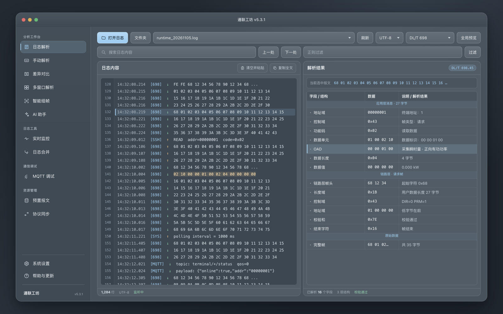
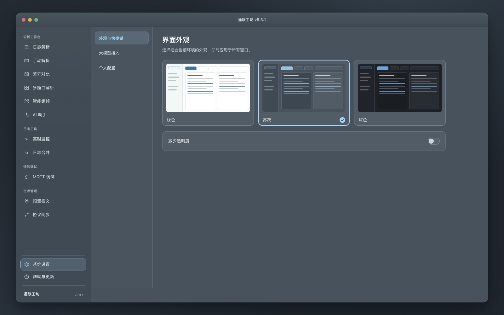
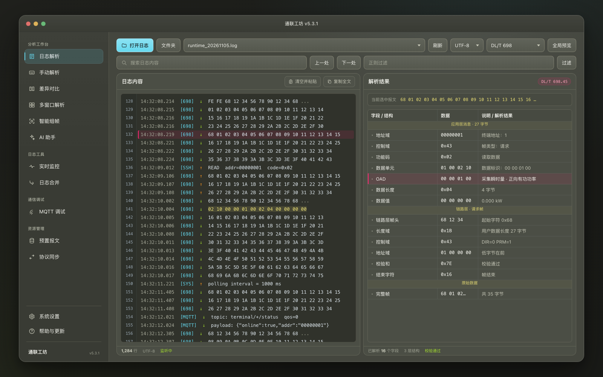
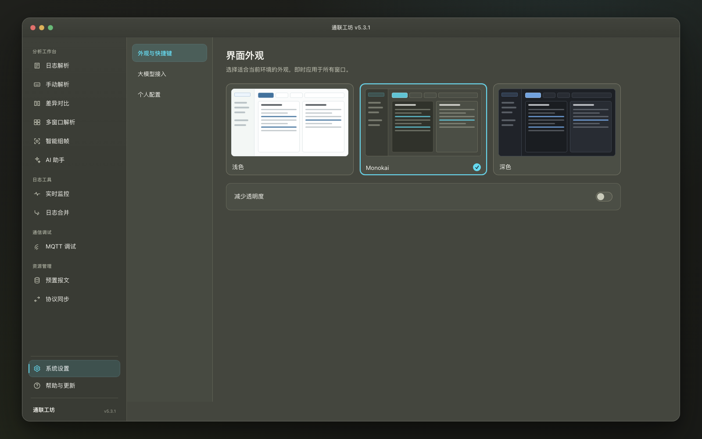
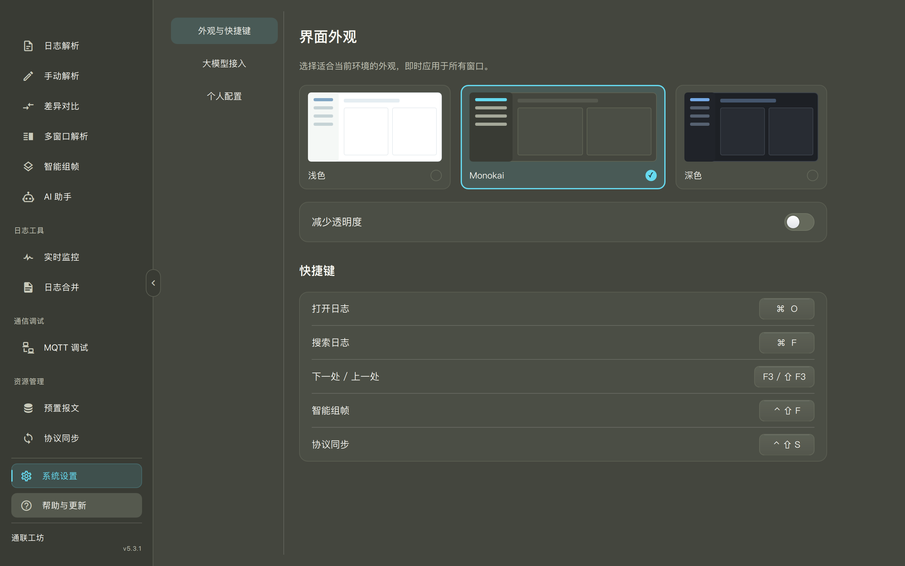

# 中间调外观视觉稿

设计日期：2026-11-05

分支：`codex/monokai-theme`

## 方向

第三套外观暂名“雾灰”。它保留现有布局、蓝色强调色和原生玻璃机制，只替换配色层级：

| 用途 | 色值 |
|---|---|
| 工作背景 | `#48525c` |
| 侧栏 | `#404a54` |
| 内容面 | `#515c66` |
| 控件 | `#59646f` |
| 阅读区 | `#3d4751` |
| 正文 | `#f3f6f8` |
| 次要文字 | `#cbd4db` |
| 强调蓝 | `#a8d4f5` |

正文/工作背景为 7.34:1，正文/内容面为 6.30:1，次要文字/内容面为 4.55:1，日志正文/阅读区为 7.42:1。阅读区继续低于内容面亮度，避免中间调变成整屏发灰的浅色。

## 预览文件

- `workspace.html` / `workspace.png`：日志解析主工作区。
- `settings.html` / `settings.png`：三选一外观设置。
- `mockup.css` / `settings.css`：视觉稿样式。

以上为浏览器视觉稿，不代表 Qt/AppKit 实际材质、主题持久化或成品应用已完成验证。

## Monokai 中灰版本

经典 Monokai 的底色 `#272822` 仍偏暗，因此这一版只借用其暖炭色和语法色体系，整体提高到中灰亮度：

| 用途 | 色值 |
|---|---|
| 工作背景 | `#44463e` |
| 侧栏 | `#393b34` |
| 内容面 | `#4b4e45` |
| 阅读区 | `#30322b` |
| 正文 | `#f8f8f2` |
| 次要文字 | `#c9caba` |
| UI 强调 | `#66d9ef` |
| 选中标记 | `#f92672` |
| 命中/标签 | `#e6db74` |
| 成功/结果 | `#a6e22e` |
| 上行/警示 | `#fd971f` |

日志正文/阅读区对比度为 12.18:1，正文/工作背景为 8.99:1，次要文字/内容面为 5.11:1。青色用于主要操作与导航，粉色只用于选中线和轻量标记，避免大面积高饱和色。
