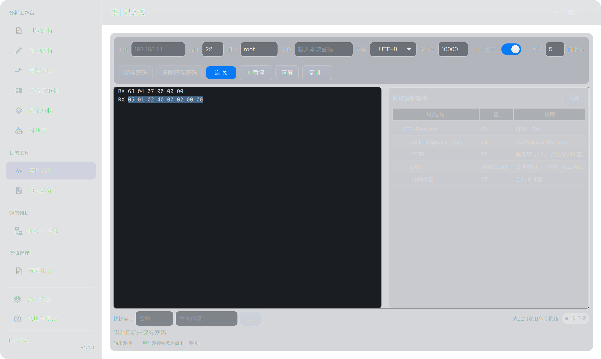

# SSH 监控第一阶段性能与功能验收

本次完成现有 SSH 监控链路优化，并交付 macOS arm64 本地 Release 应用。单会话 60 分钟、三会话 10 分钟和功能回归通过；接收处理延迟明显下降，高负载吞吐提高。**标准负载 CPU 降低 30% 的目标未达到**，不能将本次验收描述为所有性能目标均已达标。

## 测试条件和测量边界

- 测试日期：2026 年 10 月 19 至 20 日；Apple M5 Max，18 核，48 GiB 内存，macOS 26.6.2，Qt 6.11.1，libssh2 1.11.0，OpenSSL 3.6.3；测试服务端为独立环境中的 Paramiko 5.1.0。
- 基线先冻结旧源码与 QML，再构建 Release。优化版同样使用 Release、5000 行历史、1280 × 900 窗口。每条记录 512 字节，带会话号、连续序号、同机发送时间、中文和十六进制内容。压力程序逐条检查序号、会话、固定中文与报文后缀；边界和突发功能用例另外核对完整字符串。
- 使用真实加密 SSH 回环连接和生产 `SshTerminal`、`LiveLogDialog`；测试凭据与配置隔离，无关业务后端由测试替身提供。完整应用中的实际协议解析另行通过成品界面验收。
- CPU 100% 表示占满一个核心。CPU、RSS 均为测量程序进程值，包含 Qt 与校验器开销，不能直接当作完整应用总占用。RSS 每秒采样，不等同于 macOS physical footprint。
- 数据到模型延迟从同机发送时间起算，包含传输等待；模型到 Qt 帧交换和最新可见记录到帧交换另列。它们是软件观测指标，不是逐条日志的物理显示延迟，不能将两个 P95 简单相加后宣称端到端 P95。
- 本轮为单次对照，长测期间还运行了独立功能验收和打包；窗口遮挡、系统调度及并行任务会影响 CPU。结果支持本机能力结论，不提供统计置信区间。

## 标准负载前后对照

基线为 1 MiB/s、600 秒；优化版取同一最终 60 分钟运行的首个 600 秒快照。采样触发有小量时间差，CPU 已按各自实际耗时归一化。

| 指标 | 优化前 | 优化后 |
|---|---:|---:|
| 实际测量时长 | 600.483 s | 600.965 s |
| 完整核验记录 | 1,228,800 | 1,230,720 |
| 丢失、乱序或内容错误 | 0 | 0 |
| 发送到模型 P95 | 487 ms | 158 ms |
| 模型到下一次 Qt 帧交换 P95 | 31 ms | 11 ms |
| 最新提交记录发送到 Qt 帧交换 P95 | 57 ms | 48 ms |
| GUI 心跳额外延迟 P99 | 27 ms | 3 ms |
| 平均 CPU 占一个核心 | 7.85% | 8.11% |
| 采样 RSS 峰值 | 199.89 MiB | 193.00 MiB |
| 正常滚动时模型重置 | 1196 次 | 0 次 |

发送到模型 P95 降低约 67.6%。常规负载 CPU 基本持平，本次单次测量略升，没有达到降低 30% 的期望。优化版在 10 分钟内提交 3656 个显示批次，旧版为 1201 个，以更频繁的显示换取更低延迟；早期采样也定位到列表布局和文本显示开销。已采用普通 Text 与按需 TextEdit，但本阶段不继续扩展为自定义渲染器。

依据：[基线统计](ssh-stage1-2026-10-20/baseline-final-1mib-600s.json)、[最终长测统计与首 600 秒快照](ssh-stage1-2026-10-20/optimized-final-1mib-3600s.json)。

## 高负载和搜索

| 条件 | 优化前 | 优化后 | 结果 |
|---|---:|---:|---|
| 目标 5 MiB/s，共 50 MiB，核验完成耗时 | 32.418 s | 10.220 s | 全部 102400 行正确 |
| 同一 50 MiB 的实际处理速率 | 1.542 MiB/s | 4.892 MiB/s | 约 3.17 倍 |
| 同一 50 MiB 的 CPU 时间 | 2.701 CPU s | 1.060 CPU s | 减少约 60.8% |
| 目标 2 MiB/s，共 20 MiB | 未单列基线 | 10.281 s | 全部 40960 行正确 |
| 1 MiB/s，搜索开启 60 秒，CPU | 9.58% | 5.03% | 全部 122880 行正确 |
| 同上，发送到模型 P95 | 491 ms | 155 ms | 历史满后继续增量搜索 |

5 MiB/s 为 10 秒能力测量，不是最大极限速率或持续一小时的保证。高负载的 CPU 时间按相同处理量比较；它不能替代标准负载下“平均 CPU 降低 30%”的目标。搜索对照为单次短测，不推广为稳定的 CPU 降幅承诺。

## 长时间与并发验收

最终 1 MiB/s 运行 3600.330 秒，完整核验 7,372,800 行、3600 MiB 数据，内容错误和溢出信号均为 0，正常滚动模型重置为 0。采样 RSS 峰值 193.05 MiB，结束 186.70 MiB。预热后的驻留内存区间如下。

| 时间区间 | RSS 中位数 MiB | 采样范围 MiB |
|---|---:|---:|
| 10–20 分钟 | 192.95 | 188.27–193.05 |
| 20–30 分钟 | 186.42 | 186.23–188.52 |
| 30–40 分钟 | 186.42 | 186.31–186.56 |
| 40–50 分钟 | 186.50 | 186.31–186.62 |
| 50–60 分钟 | 186.61 | 186.47–186.75 |

三条独立 SSH 会话各 512 KiB/s、持续 600 秒，共核验 1,843,200 行、900 MiB，无串流或内容错误；该进程平均 CPU 2.39%、采样 RSS 峰值 90.27 MiB。此项为无界面的底层并发测试。

另做 60 秒公平性检查：会话 0 把每五秒的数据集中在约半秒发送，瞬时约 5 MiB/s；会话 1 和 2 仍以 512 KiB/s 持续输出。三会话各核验 61440 行，后两会话最长提交间隔为 209 / 198 ms，未被突发会话阻塞。

真实命令输入框探针在 1 MiB/s 下完成 290 次按键，P95 小于 1 ms（1 ms 计时分辨率）、最大 2 ms，失败 0。滚动、暂停、切页已作功能回归；未分别建立每项操作的响应时间分布，因此不将“所有操作 P95 ≤ 100 ms”标为完整量化验收通过。

依据：[三会话](ssh-stage1-2026-10-20/optimized-final-three-600s.json)、[突发公平性](ssh-stage1-2026-10-20/optimized-final-three-burst-60s.json)、[真实输入](ssh-stage1-2026-10-20/optimized-final-input-60s.json)。

## 实现和容量边界

| 环节 | 最终行为 |
|---|---|
| 接收 | socket 就绪驱动，单轮最多 256 KiB 或约 2 ms，给发送、取消和其他工作保留调度机会 |
| 文本处理 | 工作线程增量 UTF-8、GB 编解码及 ANSI/换行状态；跨包保留字符和控制序列 |
| 待提交队列 | 每会话按 4 MiB 预算计费，达到高水位暂停读，消费后恢复；不任意丢弃原始字节 |
| UI 提交 | 前台 150 ms，后台 500 ms；每批最多 4096 行、2 MiB，积压有界续处理 |
| 历史 | 配置行数与 32 MiB 字节预算同时生效；稳定行标识维护搜索、选择和回看；滚动淘汰不重置模型 |
| 长行 | 最多 8192 个 UTF-16 单元一个片段，不拆代理对；保留逻辑行关联，缺失前段或未完结时明确标记并禁止当作完整报文解析 |
| Tab | 截获上限 256 KiB，超额与迟到响应经相同接收预算恢复；空行密集响应也不一次无限展开 |
| 生命周期 | 会话代次和内容修订隔离清空、断开、重连，避免旧批次回流 |
| 显示 | 普通行用 Text，需要报文选择时按需创建 TextEdit；保留现有解析和复制行为 |

字节预算计入字符串容量和记录对象；容器、分配器、Qt 视图等额外开销由 RSS 另行观察。有限历史仍会淘汰旧记录，全文复制只覆盖当前保留历史。GB 使用系统转换能力，未添加第三方运行库；构建要求明确为 Qt 6.11 或更高，与现有 6.11.1 环境一致。

## 功能回归

| 检查 | 结果 |
|---|---|
| 解码与模型 72 项断言 | 通过；覆盖任意分块 UTF-8/ANSI/CRLF、GB、BOM、EOF、长行、容量和稳定 ID；含 Qt 模型一致性检查 |
| 真实加密流 43 项断言 | 通过；Tab 唯一补全、候选、超时、超额恢复，307200 条空记录及结束标记、65536 条突发记录、20 万字符命令部分写、清空、剪贴板、后台和重连 |
| AddressSanitizer 与 UndefinedBehaviorSanitizer | 上述解码模型与真实流检查通过，未报告内存安全或未定义行为错误 |
| 既有 SSH 成功会话 37 项与安全回归 | 通过；凭据操作、主机密钥确认与拒绝、连接生命周期、自动重连等使用隔离测试替身或回环服务 |
| QML 17 项 | 通过；保留原连接栏、编码宽度、键盘操作，新增搜索淘汰、选中高亮、暂停视口和空行高度检查 |
| 完整 Release 成品原生界面 | 通过；实际选行及右键解析 IEC 104/698，并校验真实解析字段，包含 OAD 40000200；合并刷新下暂停视口稳定 |
| 完整应用原有回归 | 通过；配置迁移、提示词保留、11 个页签、工作区恢复、损坏保护、MQTT 本机发布订阅与助手清理 |
| macOS 包 | 126 个 Mach-O 架构与依赖检查、本地签名校验、移除开发环境路径后的 Cocoa 成品回归通过 |

生产源文件与验收版本的 SHA-256 见 [源码清单](ssh-stage1-2026-10-20/validated-source-hashes.json)。

## 原有工作与交付

保留原工作区的 8 个未触及文件，哈希一致；与本次重叠的 `LiveLogDialog.qml`、`MigrationUiChecks.h`、`tst_remote_security.qml` 中，原有新增内容按原顺序保留，相关连接栏与编码显示回归通过。详情见 [保留检查](ssh-stage1-2026-10-20/preservation-check.json)。改动尚未提交或推送。

本地应用继续位于 `release_package/通联工坊-20261019-本地验证/通联工坊.app`，4.4.0，Release，macOS arm64，本地 ad-hoc 签名。旧测试应用保留作回退；未替换 `/Applications` 安装版，未修改用户配置、未公证或发布。

应用可执行文件 SHA-256：`8055b4b6cc7109121f7235370b9375d70961002bd83650d79a9d52b3c862ef5b`。

压力载荷在线生成并在 RAM 内核验，未落盘。最终验收的临时配置、应用诊断日志与截图使用已确认的 1 GiB RAM 文件系统；只将应用成品、必要截图和小型统计报告保留到磁盘。运行期间检查到 Swapouts 为 0。测试结束后已释放该 RAM 设备（[释放记录](ssh-stage1-2026-10-20/ram-teardown.json)）；构建缓存、独立测试依赖与回退应用暂留，未擅自清理其他目录。

## 待验证项目

- Windows 构建、Windows 实机显示、真实设备与真实网络日志仍待验证；macOS 结果不能替代这些验收。
- 系统真实钥匙串、本次之外的远端服务器行为，以及断线前已在远端丢失的数据，不由合成回环测试证明。
- 优化版已测的数据到模型和 Qt 帧交换延迟 P95 均低于 200 ms，但逐条日志物理上屏和所有本地操作的 P95 未完整量化。
- 本阶段未增加完整日志保存、多设备管理界面或完整 VT 终端模拟。

复现入口及参数说明见 [性能测试说明](../../tests/ssh-performance/README.md)。普通压力、搜索、三会话和公平性统计均保留在同名证据目录；大量日志载荷不作为交付物保存。
